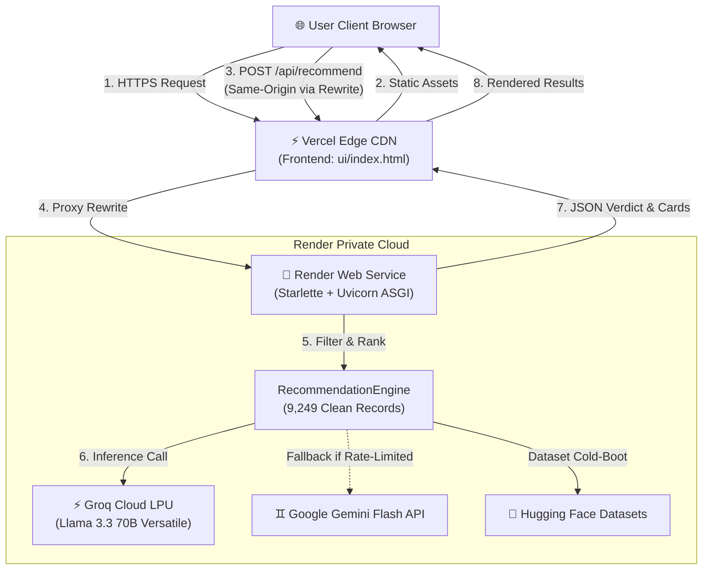

# Production Deployment Plan: Render & Vercel
## Zomato AI Restaurant Recommendation System

This document outlines the step-by-step production deployment strategy for the Zomato AI Concierge application, separating the **Python ASGI Backend (Render)** from the **Tailwind/HTML5 Frontend (Vercel)**.

---

## 1. System Architecture & Topology

The production architecture decouples compute-intensive machine learning & LLM orchestration from static edge asset delivery:



### Architectural Highlights
- **Frontend (Vercel)**: Hosted globally on Vercel's Edge Network for instant TTFB (<50ms), automatic HTTPS, and asset caching.
- **Backend (Render)**: Python 3.11 ASGI service executing multi-criteria constraint filtering, dataset memory caching, and Groq Llama 3.3 70B inference.
- **Reverse Proxy Rewrites**: Vercel acts as a reverse proxy for `/api/*` endpoints, routing traffic directly to Render. This eliminates CORS preflight latency (`OPTIONS` overhead) and prevents cross-site security warnings.

---

## 2. Pre-Deployment Preparation Checklist

Ensure your repository is clean and pre-configured before connecting to Render or Vercel:

| # | Item | Status | Verification File |
|---|------|--------|-------------------|
| 1 | Dependencies updated with ASGI server | ✅ Verified | [requirements.txt](file:///c:/Projects/Zomato_recommendation/requirements.txt) (`uvicorn`, `starlette`, `pyarrow`) |
| 2 | Heavy raw parquet caches ignored in Git | ✅ Verified | [.gitignore](file:///c:/Projects/Zomato_recommendation/.gitignore) (`data/cache/`, `*.parquet`) |
| 3 | API base URL supports relative routing & proxying | ✅ Verified | [ui/index.html](file:///c:/Projects/Zomato_recommendation/ui/index.html) |
| 4 | Render Blueprint configuration created | ✅ Verified | [render.yaml](file:///c:/Projects/Zomato_recommendation/render.yaml) |
| 5 | Vercel rewrite configuration created | ✅ Verified | [vercel.json](file:///c:/Projects/Zomato_recommendation/vercel.json) |
| 6 | Groq API Key generated & active | ⚠️ User Action | [Groq Console](https://console.groq.com/keys) |

> [!IMPORTANT]
> **Dataset Size & Git LFS Notice**:
> The raw parquet dataset is ~147MB and is correctly excluded from GitHub via [.gitignore](file:///c:/Projects/Zomato_recommendation/.gitignore). On Render, `DatasetLoader` automatically downloads the dataset from Hugging Face (`ManikaSaini/zomato-restaurant-recommendation`) on initial boot and processes it down to **9,249 clean rows** (~43MB RAM usage), staying well within Render's 512MB free-tier memory limit.

---

## 3. Phase 1: Deploying Backend to Render

Render will host the ASGI REST API providing `/api/options`, `/api/recommend`, and `/api/health`.

### Option A: 1-Click Deployment via Render Blueprint (Recommended)
1. Commit and push your code to your GitHub repository (e.g., `main` branch).
2. Log in to your [Render Dashboard](https://dashboard.render.com/).
3. Click **New +** → **Blueprint**.
4. Connect your GitHub repository. Render will automatically detect [render.yaml](file:///c:/Projects/Zomato_recommendation/render.yaml).
5. Fill in the secret environment variables (`GROQ_API_KEY` and optional `GEMINI_API_KEY`).
6. Click **Apply**.

---

### Option B: Manual Web Service Setup via Render GUI
If you prefer configuring via the web dashboard:

1. Click **New +** → **Web Service**.
2. Select your repository: `Zomato_recommendation`.
3. Configure the service settings:
   - **Name**: `zomato-ai-backend`
   - **Region**: Choose closest to target diners (e.g., *Singapore* or *Frankfurt*)
   - **Branch**: `main`
   - **Root Directory**: Leave blank (repository root)
   - **Runtime**: `Python 3`
   - **Build Command**:
     ```bash
     pip install -r requirements.txt
     ```
   - **Start Command**:
     ```bash
     uvicorn ui.server:app --host 0.0.0.0 --port $PORT --workers 1
     ```
   - **Instance Type**: `Free` ($0/month)

4. **Health Check Path**:
   - Expand **Advanced**.
   - Set **Health Check Path** to `/api/health`.

5. **Environment Variables**:
   Add the following under the **Environment** tab:

| Variable Name | Required | Default / Recommended Value | Description |
|---------------|:--------:|-----------------------------|-------------|
| `PYTHON_VERSION` | Yes | `3.11.9` | Pins stable Python runtime |
| `GROQ_API_KEY` | Yes | `gsk_...` | Groq API Key for Llama 3.3 70B inference |
| `GEMINI_API_KEY` | Optional | `AIza...` | Secondary fallback model key |
| `DATASET_NAME` | No | `ManikaSaini/zomato-restaurant-recommendation` | Hugging Face remote dataset |
| `LLM_MODEL` | No | `llama-3.3-70b-versatile` | Groq model identifier |
| `PORT` | Auto | (Injected by Render) | Dynamic port allocation |

6. Click **Create Web Service**.
7. Note down your Render service URL once deployed (e.g., `https://zomato-ai-backend.onrender.com`).

---

### Render Free-Tier Optimization & Cold-Starts
- **Cold Boot Behavior**: Render free tier spins down instances after 15 minutes of inactivity. The initial wake-up takes ~30-40 seconds.
- **Keep-Alive Solution**: Set up a free ping monitor (e.g., [cron-job.org](https://cron-job.org) or [UptimeRobot](https://uptimerobot.com)) calling:
  ```http
  GET https://zomato-ai-backend.onrender.com/api/health
  ```
  every **10 minutes** to keep the service warm 24/7.

---

## 4. Phase 2: Deploying Frontend to Vercel

Vercel will serve the Stitch dark-theme interface with high-speed asset distribution and proxy `/api/*` calls to Render.

### Step 1: Update Vercel Rewrite Destination
In your project's [vercel.json](file:///c:/Projects/Zomato_recommendation/vercel.json), replace `https://zomato-ai-backend.onrender.com` with your exact Render service URL:

```json
{
  "version": 2,
  "cleanUrls": true,
  "rewrites": [
    {
      "source": "/api/:match*",
      "destination": "https://YOUR-ACTUAL-RENDER-URL.onrender.com/api/:match*"
    },
    {
      "source": "/",
      "destination": "/ui/index.html"
    },
    {
      "source": "/(.*)",
      "destination": "/ui/$1"
    }
  ]
}
```

Commit and push this change to your repository.

---

### Step 2: Deploy on Vercel Dashboard

1. Log in to [Vercel](https://vercel.com).
2. Click **Add New...** → **Project**.
3. Import your GitHub repository: `Zomato_recommendation`.
4. Configure the Project:
   - **Framework Preset**: `Other`
   - **Root Directory**: `./` (Default root)
   - **Build & Output Settings**: Leave defaults (Static site, no build step required).
5. Click **Deploy**.
6. Within 15 seconds, your application will be live at a public URL (e.g., `https://zomato-recommendation.vercel.app`).

---

## 5. Phase 3: Integration & Security Validation

### 5.1 Verification Commands (Smoke Tests)

Execute these checks to confirm both services communicate properly:

#### Test 1: Render Health Check
```bash
curl -I https://YOUR-ACTUAL-RENDER-URL.onrender.com/api/health
# Expected: HTTP/2 200 OK
```

#### Test 2: Options Query
```bash
curl -s https://YOUR-ACTUAL-RENDER-URL.onrender.com/api/options | jq .total_spots
# Expected: 9249
```

#### Test 3: Recommendation Pipeline (Groq Llama 3.3 70B)
```bash
curl -X POST https://YOUR-ACTUAL-RENDER-URL.onrender.com/api/recommend \
  -H "Content-Type: application/json" \
  -d '{"location": "Indiranagar", "cuisine": "Italian", "min_rating": 4.0, "top_n": 3}' \
  | jq '.recommendations[0].name'
# Expected: Restaurant name (e.g. "The Pizza Bakery" or "Milano Sourdough & Trattoria")
```

#### Test 4: Vercel Proxy Route
```bash
curl -s https://YOUR-VERCEL-DOMAIN.vercel.app/api/options | jq .total_regions
# Expected: 93 (confirms Vercel proxy rewrite reaches Render)
```

---

## 6. Frontend Verification Checklist

Open your Vercel deployment URL (`https://YOUR-VERCEL-DOMAIN.vercel.app`) in a browser:

- [ ] **Initial Page Load**: UI matches [stitch/screen.png](file:///c:/Projects/Zomato_recommendation/stitch/screen.png) with deep `#0D0D12` background, sidebar inputs, and hero stats.
- [ ] **Live Bangalore Engine Indicator**: Emerald dot pulses at the top header.
- [ ] **1-Click Presets**: Clicking *Romantic Date Night*, *Cozy Italian Pizza*, *Work-Friendly Cafe*, or *Authentic Desi Feast* immediately populates filters and loads cards.
- [ ] **Form Submission**: Adjusting Area, Budget radio pills, Rating slider, and entering custom vibe in the textarea updates recommendations upon clicking **Consult AI Critic**.
- [ ] **Loading Animation**: Button displays *Consulting AI Critic...* with skeleton shimmer during LLM round-trip.
- [ ] **Diner Details Accordion**: Expanding *📋 Diner Details & Amenities* opens the 6-item amenities grid.
- [ ] **CSV Export**: Clicking *Export Recommendations (CSV)* generates and downloads `Zomato_AI_Bangalore_Recommendations.csv`.

---

## 7. Troubleshooting & Operational Runbook

| Symptom | Probable Cause | Corrective Action |
|---------|----------------|-------------------|
| **502 Bad Gateway / Cold Start Delay** | Render free instance sleeping | Allow 30–45s for initial wake-up. Set up an automated UptimeRobot pinger on `/api/health`. |
| **CORS Error in Browser Console** | Calling Render URL directly without CORS origin | Ensure requests use relative `/api/...` so Vercel proxies them, or confirm `CORSMiddleware` in `ui/server.py` has `allow_origins=["*"]`. |
| **Dataset Download Timeout on Boot** | Hugging Face network latency | Increase Render start timeout or pre-cache dataset; verify `requirements.txt` has `datasets>=2.16.0` and `pyarrow`. |
| **LLM Fallback Triggered** | Groq API rate limit or missing key | Check Render logs for `GroqError` or rate limits; verify `GROQ_API_KEY` is present in Render environment variables. |
| **Out of Memory Crash on Render** | Pandas processing all 51K rows | The preprocessor in `src/data/preprocessor.py` drops redundant columns and deduplicates rows to 9.2K rows (~43MB), well below 512MB. Avoid loading non-essential columns. |

---

## 8. Summary of Created Configuration Files

- [render.yaml](file:///c:/Projects/Zomato_recommendation/render.yaml): Infrastructure-as-Code for Render Web Service deployment.
- [vercel.json](file:///c:/Projects/Zomato_recommendation/vercel.json): Vercel routing rules, API proxy rewrite, and HTTP security headers.
- [ui/server.py](file:///c:/Projects/Zomato_recommendation/ui/server.py): Starlette ASGI server with dynamic port support and REST API routes.
- [ui/index.html](file:///c:/Projects/Zomato_recommendation/ui/index.html): Dark theme frontend with relative `/api` integration.
- [requirements.txt](file:///c:/Projects/Zomato_recommendation/requirements.txt): Pinned production dependencies.
