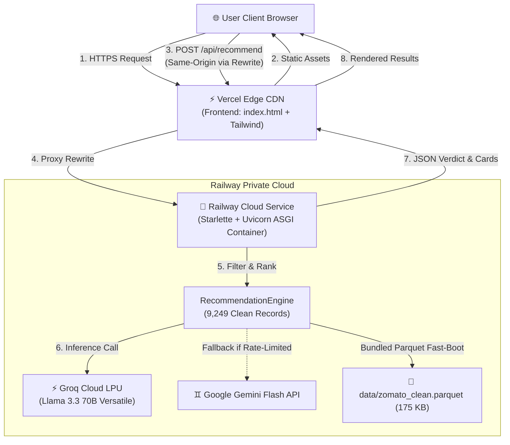

# Production Deployment Plan: Railway & Vercel
## Zomato AI Restaurant Recommendation System

This document outlines the step-by-step production deployment strategy for the Zomato AI Concierge application, separating the **Python ASGI Backend (Railway)** from the **Tailwind/HTML5 Frontend (Vercel)**.

---

## 1. System Architecture & Topology

The production architecture decouples compute-intensive machine learning & LLM orchestration from static edge asset delivery:



### Architectural Highlights
- **Frontend (Vercel)**: Hosted globally on Vercel's Edge Network for instant TTFB (<50ms), automatic HTTPS, and asset caching.
- **Backend (Railway)**: Containerized Python 3.11 ASGI service orchestrated by Nixpacks. Executes multi-criteria constraint filtering, dataset memory caching, and Groq Llama 3.3 70B inference with high reliability and zero cold-boot timeouts.
- **Reverse Proxy Rewrites**: Vercel acts as a reverse proxy for `/api/*` endpoints, routing traffic directly to Railway. This eliminates CORS preflight latency (`OPTIONS` overhead) and prevents cross-site security warnings.

---

## 2. Pre-Deployment Preparation Checklist

Ensure your repository is configured before connecting to Railway or Vercel:

| # | Item | Status | Verification File |
|---|------|--------|-------------------|
| 1 | Dependencies updated with ASGI server | ✅ Verified | [requirements.txt](file:///c:/Projects/Zomato_recommendation/requirements.txt) (`uvicorn`, `starlette`, `pyarrow`) |
| 2 | Railway configuration defined | ✅ Verified | [railway.json](file:///c:/Projects/Zomato_recommendation/railway.json) & [Procfile](file:///c:/Projects/Zomato_recommendation/Procfile) |
| 3 | Heavy raw parquet caches ignored in Git | ✅ Verified | [.gitignore](file:///c:/Projects/Zomato_recommendation/.gitignore) (`data/cache/`, `*.parquet`) |
| 4 | Clean production dataset bundled (175 KB) | ✅ Verified | [data/zomato_clean.parquet](file:///c:/Projects/Zomato_recommendation/data/zomato_clean.parquet) |
| 5 | Vercel rewrite configuration created | ✅ Verified | [vercel.json](file:///c:/Projects/Zomato_recommendation/vercel.json) |
| 6 | Groq API Key generated & active | ⚠️ User Action | [Groq Console](https://console.groq.com/keys) |

> [!NOTE]
> **Instant Boot with Bundled Dataset**:
> The preprocessed clean dataset (**9,249 restaurants**, 175 KB) is bundled at [data/zomato_clean.parquet](file:///c:/Projects/Zomato_recommendation/data/zomato_clean.parquet). On Railway, the backend initializes in **~2 seconds** with ~10 MB RAM, completely bypassing slow remote dataset downloads.

---

## 3. Phase 1: Deploying Backend to Railway

Railway will host the containerized ASGI REST API providing `/api/options`, `/api/recommend`, and `/api/health`.

### Option A: Railway Dashboard Deployment (Recommended)

1. Log in to your [Railway Dashboard](https://railway.app/).
2. Click **+ New Project** → **Deploy from GitHub repo**.
3. Select your repository: `snigdhapanda1410/Zomato_Recommendations`.
4. Railway will automatically detect Python, [requirements.txt](file:///c:/Projects/Zomato_recommendation/requirements.txt), [railway.json](file:///c:/Projects/Zomato_recommendation/railway.json), and [Procfile](file:///c:/Projects/Zomato_recommendation/Procfile).
5. **Set Environment Variables**:
   In your Railway project service, go to the **Variables** tab and add:

| Variable Name | Required | Default / Recommended Value | Description |
|---------------|:--------:|-----------------------------|-------------|
| `GROQ_API_KEY` | **Yes** | `gsk_...` | Groq API Key for Llama 3.3 70B inference |
| `GEMINI_API_KEY` | Optional | `AIza...` | Secondary fallback model key |
| `PYTHON_VERSION` | No | `3.11.9` | Pins stable Python runtime |
| `DATASET_NAME` | No | `ManikaSaini/zomato-restaurant-recommendation` | Hugging Face remote dataset fallback |
| `LLM_MODEL` | No | `llama-3.3-70b-versatile` | Groq model identifier |
| `PORT` | Auto | *(Injected by Railway)* | Dynamic port allocation |

6. **Generate a Public Domain**:
   - In your Railway project, click on your service.
   - Go to **Settings** → **Networking** (or **Public Networking**).
   - Click **Generate Domain**.
   - Note down the generated domain URL (e.g., `https://zomato-ai-backend.up.railway.app`).

7. **Healthcheck Configuration** (handled automatically by `railway.json`):
   - Path: `/api/health`
   - Timeout: `100s`

---

### Option B: Railway CLI Deployment
If you prefer deploying via terminal:
```bash
# 1. Install Railway CLI (if not already installed)
npm install -g @railway/cli   # or via scoop/brew

# 2. Authenticate
railway login

# 3. Link or create project
railway init

# 4. Set secrets
railway variables set GROQ_API_KEY="gsk_..."

# 5. Deploy
railway up
```

---

## 4. Phase 2: Deploying Frontend to Vercel

Vercel will serve the Stitch dark-theme interface with global Edge distribution and proxy `/api/*` calls to your Railway backend.

### Step 1: Update Vercel Rewrite Destination
In your project's [vercel.json](file:///c:/Projects/Zomato_recommendation/vercel.json), set the destination to your actual Railway public domain:

```json
{
  "version": 2,
  "cleanUrls": true,
  "rewrites": [
    {
      "source": "/api/:match*",
      "destination": "https://YOUR-ACTUAL-RAILWAY-DOMAIN.up.railway.app/api/:match*"
    }
  ],
  "headers": [
    {
      "source": "/(.*)",
      "headers": [
        {
          "key": "X-Content-Type-Options",
          "value": "nosniff"
        },
        {
          "key": "X-Frame-Options",
          "value": "DENY"
        },
        {
          "key": "X-XSS-Protection",
          "value": "1; mode=block"
        }
      ]
    }
  ]
}
```

Commit and push this change to your repository:
```bash
git add vercel.json
git commit -m "chore: point vercel rewrite to railway backend domain"
git push origin main
```

---

### Step 2: Deploy on Vercel Dashboard

1. Log in to [Vercel](https://vercel.com).
2. Click **Add New...** → **Project**.
3. Import your GitHub repository: `snigdhapanda1410/Zomato_Recommendations`.
4. Configure the Project:
   - **Framework Preset**: `Other`
   - **Root Directory**: `./` (Default root where `index.html` is located)
   - **Build & Output Settings**: Leave defaults (Static site, no build step required).
5. Click **Deploy**.
6. Within 15 seconds, your application will be live at a public URL (e.g., `https://zomato-recommendations.vercel.app`).

---

## 5. Phase 3: Integration & Security Validation

### 5.1 Verification Commands (Smoke Tests)

Execute these checks to confirm both services communicate properly:

#### Test 1: Railway Backend Health Check
```bash
curl -I https://YOUR-ACTUAL-RAILWAY-DOMAIN.up.railway.app/api/health
# Expected: HTTP/2 200 OK
```

#### Test 2: Options Query
```bash
curl -s https://YOUR-ACTUAL-RAILWAY-DOMAIN.up.railway.app/api/options | jq .total_spots
# Expected: 9249
```

#### Test 3: Recommendation Pipeline (Groq Llama 3.3 70B)
```bash
curl -X POST https://YOUR-ACTUAL-RAILWAY-DOMAIN.up.railway.app/api/recommend \
  -H "Content-Type: application/json" \
  -d '{"location": "Indiranagar", "cuisine": "Italian", "min_rating": 4.0, "top_n": 3}' \
  | jq '.recommendations[0].name'
# Expected: Restaurant name (e.g., "The Pizza Bakery" or "Milano Sourdough & Trattoria")
```

#### Test 4: Vercel Proxy Route
```bash
curl -s https://YOUR-VERCEL-DOMAIN.vercel.app/api/options | jq .total_regions
# Expected: 93 (confirms Vercel proxy rewrite reaches Railway)
```

---

## 6. Frontend Verification Checklist

Open your Vercel deployment URL (`https://YOUR-VERCEL-DOMAIN.vercel.app`) in a browser:

- [ ] **Initial Page Load**: UI matches [stitch/screen.png](file:///c:/Projects/Zomato_recommendation/stitch/screen.png) with deep `#0D0D12` background, sidebar inputs, and hero stats.
- [ ] **Live Bangalore Engine Indicator**: Emerald dot pulses at the top header.
- [ ] **1-Click Presets**: Clicking *Romantic Date Night*, *Cozy Italian Pizza*, *Work-Friendly Cafe*, or *Authentic Desi Feast* immediately populates filters and loads cards.
- [ ] **Form Submission**: Adjusting Area, Budget radio pills, Rating slider, and entering custom vibe in the textarea updates recommendations upon clicking **Consult AI Critic**.
- [ ] **Loading Animation**: Button displays *Consulting AI Critic...* with skeleton shimmer during LLM round-trip.
- [ ] **Diner Details Accordion**: Expanding *📋 Diner Details & Amenities* opens the 6-item amenities grid.
- [ ] **CSV Export**: Clicking *Export Recommendations (CSV)* generates and downloads `Zomato_AI_Bangalore_Recommendations.csv`.

---

## 7. Troubleshooting & Operational Runbook

| Symptom | Probable Cause | Corrective Action |
|---------|----------------|-------------------|
| **Cannot GET / or 502 Bad Gateway** | Railway domain not generated or service failed to start | In Railway dashboard, ensure **Networking** → **Generate Domain** is clicked. Check the **Deploy Logs** tab for any Python startup errors. |
| **CORS Error in Browser Console** | Calling Railway URL directly instead of using relative `/api` | Ensure requests use relative `/api/...` so Vercel proxies them, or confirm `CORSMiddleware` in `ui/server.py` has `allow_origins=["*"]`. |
| **LLM Fallback Triggered** | Groq API rate limit or missing key | Check Railway deployment logs for `GroqError` or rate limits; verify `GROQ_API_KEY` is set under the **Variables** tab. |
| **Out of Memory Crash on Railway** | Excessive in-memory DataFrame operations | The bundled dataset `data/zomato_clean.parquet` uses only ~10 MB RAM. If reloading raw data, verify deduplication in `src/data/preprocessor.py` is enabled. |
| **Port Binding Error** | Hardcoding port instead of using `$PORT` | Railway provides a dynamic `$PORT`. Ensure start command uses `--port $PORT` as specified in `railway.json` and `Procfile`. |

---

## 8. Summary of Configuration Files

- [railway.json](file:///c:/Projects/Zomato_recommendation/railway.json): Railway configuration specifying the Nixpacks builder, start command, and `/api/health` healthcheck.
- [Procfile](file:///c:/Projects/Zomato_recommendation/Procfile): Standard PaaS process definition (`web: uvicorn ui.server:app --host 0.0.0.0 --port $PORT`).
- [vercel.json](file:///c:/Projects/Zomato_recommendation/vercel.json): Vercel routing rules, API proxy rewrite to Railway, and HTTP security headers.
- [ui/server.py](file:///c:/Projects/Zomato_recommendation/ui/server.py): Starlette ASGI server with dynamic port support and REST API routes.
- [index.html](file:///c:/Projects/Zomato_recommendation/index.html): Dark theme frontend entry point with relative `/api` integration.
- [data/zomato_clean.parquet](file:///c:/Projects/Zomato_recommendation/data/zomato_clean.parquet): 175 KB bundled clean dataset enabling sub-second cold starts.
- [requirements.txt](file:///c:/Projects/Zomato_recommendation/requirements.txt): Pinned production dependencies.
